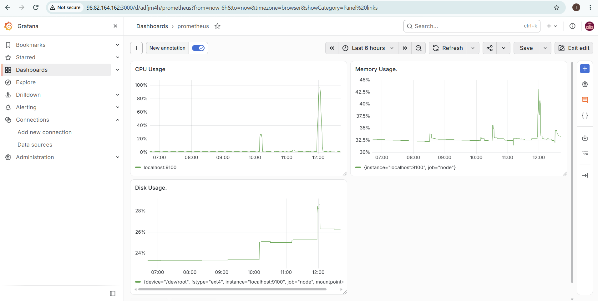
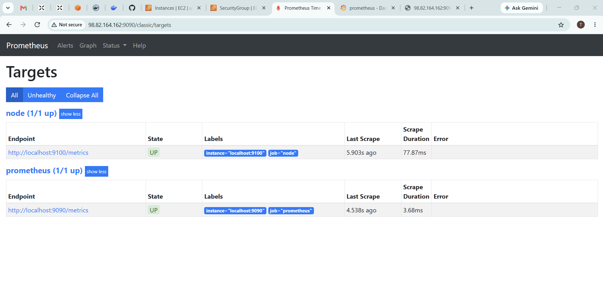

# EC2 Monitoring with Prometheus and Grafana

Monitor an Ubuntu EC2 server using Prometheus, Node Exporter, and Grafana.

## Dashboard metrics

- CPU usage (%)
- Memory usage (%)
- Root disk usage (%)

## Environment

- Ubuntu Server 24.04 LTS
- EC2 instance: t3.small
- Storage: 20 GiB gp3

## How it works

Node Exporter exposes server metrics on port 9100.
Prometheus collects those metrics.
Grafana queries Prometheus and displays graphs.

## Network settings

Allow inbound access from your own IP only:

| Service | Port |
|---|---|
| SSH | 22 |
| Grafana | 3000 |
| Prometheus | 9090 |

Node Exporter is accessed locally; no public inbound rule for port 9100 is required.

## Install Prometheus and Node Exporter

```bash
sudo apt update
sudo apt install -y prometheus prometheus-node-exporter
sudo systemctl enable --now prometheus prometheus-node-exporter
```

The repository's prometheus.yml contains the working scrape configuration.
To apply it from the repository directory:

```bash
sudo cp prometheus.yml /etc/prometheus/prometheus.yml
promtool check config /etc/prometheus/prometheus.yml
sudo systemctl restart prometheus
```

Only restart after the configuration check succeeds.

## Install Grafana

```bash
sudo apt install -y apt-transport-https wget gpg
sudo mkdir -p /etc/apt/keyrings
sudo wget -O /etc/apt/keyrings/grafana.asc https://apt.grafana.com/gpg-full.key
sudo chmod 644 /etc/apt/keyrings/grafana.asc
echo "deb [signed-by=/etc/apt/keyrings/grafana.asc] https://apt.grafana.com stable main" | sudo tee /etc/apt/sources.list.d/grafana.list
sudo apt update
sudo apt install -y grafana
sudo systemctl daemon-reload
sudo systemctl enable --now grafana-server
```

## Connect Grafana to Prometheus

1. Open http://EC2_PUBLIC_IP:3000.
2. Log in initially with admin/admin and set a new password.
3. Open Connections → Data sources → Add new data source.
4. Select Prometheus.
5. Set the server URL to http://localhost:9090.
6. Click Save & test.

## Import the dashboard

1. Open Grafana's dashboard import option.
2. Upload ec2-monitoring-dashboard.json.
3. Select the Prometheus data source if prompted.
4. Import and save the dashboard.

## Verify services

```bash
systemctl is-active prometheus prometheus-node-exporter grafana-server
```

All three should report active.

Open http://EC2_PUBLIC_IP:9090/classic/targets.
Both localhost:9090 and localhost:9100 should show UP.
Some Prometheus versions use /targets instead.

## Screenshots

### Grafana dashboard



### Prometheus targets



## Notes

- Replace EC2_PUBLIC_IP with the instance's current public IPv4 address.
- The supplied package configuration includes an optional Alertmanager target.
  Alertmanager was not installed or configured for this project.
- Never commit passwords, AWS credentials, or SSH private keys.
